# Modelo de datos por organización

El estado de la plataforma en PostgreSQL (Docker local o Cloud SQL), aislado por organización. La fuente de verdad
son las migraciones `servidor/migraciones/0001_organizaciones_y_acceso.sql`, `0002_estado_de_la_plataforma.sql` y
`0003_conexiones_archivos_y_tablas.sql`; este documento las describe. Las reglas de cifrado, retención y borrado salen
de [DATOS_SENSIBLES.md](DATOS_SENSIBLES.md); los roles, de [ROLES_Y_PERMISOS.md](ROLES_Y_PERMISOS.md); los archivos de
hoy, de [DATOS_E_INTEGRACIONES.md](DATOS_E_INTEGRACIONES.md).

## Principios

- Todo vive en el esquema `vera`. Toda tabla de una organización lleva `organizacion_id` y empieza su llave primaria
  por él. La excepción es `vera.personas`: una persona existe una vez y pertenece a varias organizaciones.
- El aislamiento lo hace la base con Row Level Security, no las consultas. Una consulta sin filtro de organización solo
  ve las filas de la organización fijada en su transacción.
- En claro va solo lo Interno: ids, organización, flujo, estado, fechas, tamaños y tipos. Basta para permisos,
  búsquedas, tableros y retención sin descifrar.
- Lo Secreto, Sensible y Personal confidencial va en columnas `bytea` cifradas por el servidor con una DEK de la
  organización. Al lado de cada una va su llave (`llave_id` o `<columna>_llave`).
- Los bytes no van a la base: archivos, adjuntos, páginas del visor, caché de conversión y copias de correos van a
  Cloud Storage bajo `org/<organización>/…`, cifrados antes de subir. En la base va solo la ficha
  (`vera.archivos`, `vera.adjuntos_conversacion`).
- Los trabajadores de Python nunca reciben credenciales de la base ni llaves: el servidor quita del entorno
  `DATABASE_URL`, `DATABASE_PASSWORD_FILE`, `DATABASE_URL_PRUEBAS`, `VERA_KEK_LOCAL`, `VERA_KEK_LOCAL_ARCHIVO` y
  `VERA_KEK_KMS` (`sinVariablesDelServidor`, `servidor/src/bd/conexion.ts`). El estado de aprobaciones y aplazadas lo
  entregan al servidor por su canal de eventos; el servidor lo guarda.
- Sin `DATABASE_URL` todo sigue en archivos, como hoy.

## Diagrama

Toda columna cifrada referencia `llaves_datos (organizacion_id, id)`; esas aristas no se dibujan. Las líneas punteadas
son referencias blandas (sin llave foránea).

```mermaid
erDiagram
  organizaciones ||--o{ membresias : tiene
  personas ||--o{ membresias : pertenece
  organizaciones ||--o{ sesiones : tiene
  personas ||--o{ sesiones : abre
  organizaciones ||--o{ llaves_datos : envuelve
  organizaciones ||--o{ auditoria : registra
  personas |o..o{ auditoria : actor
  organizaciones ||--o{ flujos : tiene
  flujos ||--o{ flujo_versiones : versiona
  flujos ||--o{ metas_version : describe
  organizaciones ||--o{ corridas : tiene
  flujos ||..o{ corridas : corre
  corridas ||--o{ eventos_corrida : tramos
  organizaciones ||--o{ aprobaciones : tiene
  corridas ||..o{ aprobaciones : pausa
  organizaciones ||--o{ aplazadas : tiene
  corridas ||..o{ aplazadas : aplaza
  flujos ||--o| programaciones : programa
  organizaciones ||--o{ marcas_programador : tiene
  organizaciones ||--o{ conversaciones : tiene
  flujos |o..o{ conversaciones : contexto
  conversaciones ||--o{ mensajes : contiene
  conversaciones ||--o{ adjuntos_conversacion : adjunta
  organizaciones ||--o{ ajustes : tiene
  organizaciones ||--o{ cambios_configuracion : registra
  organizaciones ||--o{ perfiles_configuracion : guarda
  organizaciones ||--o{ credenciales : tiene
  flujos |o--o{ credenciales : alcance
  flujos ||--o{ variables_entorno : define
  organizaciones ||--o{ archivos : guarda
  corridas |o..o{ archivos : genera
  archivos ||--o{ plantillas_documento : archivo
  organizaciones ||--o{ plantillas_documento : tiene
  organizaciones ||--o{ filas_tabla : guarda
  organizaciones ||--o{ notificaciones : avisa
  flujos ||--o| estado_disparadores : sondea
  flujos ||--o{ usos_limite : limita

  organizaciones {
    uuid id PK
    text slug "unico"
    text estado "activa suspendida en_baja"
    text kek_ref
    jsonb retencion
    timestamptz baja_pedida
  }
  personas {
    uuid id PK
    text correo "unico"
    text clave_hash
    bytea segundo_factor "cifrada"
    text estado
    timestamptz borrar_desde
  }
  membresias {
    uuid organizacion_id PK, FK
    uuid persona_id PK, FK
    text rol
    uuid invitada_por FK
    timestamptz retirada
  }
  sesiones {
    uuid id PK
    uuid organizacion_id FK
    uuid persona_id FK
    bytea token_hash "unico"
    timestamptz vence
    timestamptz cerrada
    text motivo_cierre
  }
  llaves_datos {
    uuid organizacion_id PK, FK
    uuid id PK
    text proposito "general sensible indice"
    date periodo
    bytea dek_envuelta
    timestamptz destruida
  }
  auditoria {
    uuid organizacion_id PK, FK
    bigint id PK
    timestamptz en
    text actor
    uuid persona_id "sin FK"
    text accion
    jsonb detalle
    bytea indice_ciego
  }
  flujos {
    uuid organizacion_id PK, FK
    text id PK
    text tipo "declarativo codigo"
    text base
    int version_actual
    int estructura_actual
    boolean sensible
  }
  flujo_versiones {
    uuid organizacion_id PK, FK
    text flujo_id PK, FK
    text clase PK
    int version PK
    jsonb definicion
    bytea secretos "cifrada"
  }
  metas_version {
    uuid organizacion_id PK, FK
    text flujo_id PK, FK
    int version PK
    text autor
    int restaurada_de
    bytea textos "cifrada"
  }
  corridas {
    uuid organizacion_id PK, FK
    text id PK
    timestamptz creada PK "particion"
    text flujo_id
    text estado
    text accion
    bytea contenido "cifrada"
    bytea_arr titulares
  }
  eventos_corrida {
    uuid organizacion_id PK, FK
    text corrida_id PK, FK
    timestamptz corrida_creada PK, FK "particion"
    int tramo PK
    text_arr tipos
    bytea contenido "cifrada"
  }
  aprobaciones {
    uuid organizacion_id PK, FK
    text id PK
    text flujo_id
    text corrida_id
    text estado
    timestamptz vence
    bytea contenido "cifrada"
    bytea estado_corrida "cifrada"
  }
  aplazadas {
    uuid organizacion_id PK, FK
    text id PK
    text flujo_id
    text corrida_id
    timestamptz cuando
    bytea contenido "cifrada"
  }
  programaciones {
    uuid organizacion_id PK, FK
    text flujo_id PK, FK
    text cron
    text zona
    boolean activo
  }
  marcas_programador {
    uuid organizacion_id PK, FK
    text clave PK
    bigint valor
  }
  conversaciones {
    uuid organizacion_id PK, FK
    text id PK
    uuid persona_id
    text flujo_id
    timestamptz actualizada
    bytea contenido "cifrada"
  }
  mensajes {
    uuid organizacion_id PK, FK
    text conversacion_id PK, FK
    int orden PK
    text rol
    boolean voz
    bytea contenido "cifrada"
  }
  adjuntos_conversacion {
    uuid organizacion_id PK, FK
    text conversacion_id PK, FK
    text id PK
    bigint tamano
    text objeto
    bytea contenido "cifrada"
  }
  ajustes {
    uuid organizacion_id PK, FK
    text clave PK
    jsonb valor
    timestamptz actualizado
  }
  cambios_configuracion {
    uuid organizacion_id PK, FK
    bigint id PK
    bytea huella
    timestamptz t
    text clave
    jsonb despues
  }
  perfiles_configuracion {
    uuid organizacion_id PK, FK
    text nombre PK
    timestamptz t
    jsonb configuracion
  }
  credenciales {
    uuid organizacion_id PK, FK
    text nombre PK
    text tipo
    text flujo_id
    boolean permitir_escritura
    bytea valores "cifrada"
    text secreto_ref
  }
  variables_entorno {
    uuid organizacion_id PK, FK
    text flujo_id PK, FK
    text nombre PK
    boolean secreto
    text valor
    bytea valor_cifrado "cifrada"
  }
  archivos {
    uuid organizacion_id PK, FK
    text id PK
    text clase
    text flujo_id
    text corrida_id
    text objeto
    timestamptz vence
  }
  plantillas_documento {
    uuid organizacion_id PK, FK
    text id PK
    text formato
    text archivo_id FK
    jsonb meta
    bytea texto "cifrada"
  }
  filas_tabla {
    uuid organizacion_id PK, FK
    text ambito PK
    text tabla PK
    text clave PK
    bytea datos "cifrada"
    timestamptz vence
  }
  notificaciones {
    uuid organizacion_id PK, FK
    text id PK
    text tipo
    text clave
    boolean leida
    bytea contenido "cifrada"
  }
  estado_disparadores {
    uuid organizacion_id PK, FK
    text flujo_id PK, FK
    bytea estado "cifrada"
    timestamptz actualizado
  }
  usos_limite {
    uuid organizacion_id FK
    text flujo_id FK
    text clave
    timestamptz t
  }
```



## Aislamiento por organización

### Roles de la base

| Rol | Qué es | Puede |
|---|---|---|
| `vera_app` | Rol de la aplicación. `NOLOGIN NOSUPERUSER NOCREATEDB NOCREATEROLE NOBYPASSRLS`; no es dueño de nada | `USAGE` en `vera` y los permisos por tabla de abajo. RLS siempre le aplica |
| `vera_app_login` (local) | Usuario con el que entra el servidor en Docker, miembro de `vera_app`. Lo crea `servidor/bd/inicio/10_usuario_aplicacion.sh`; su clave sale del secreto `bd_app` | Lo de `vera_app` |
| Cuenta de servicio con IAM (GCP) | El usuario de Cloud SQL del servicio, miembro de `vera_app` | Lo de `vera_app` |
| `vera_migrador` | Dueño de las tablas (`POSTGRES_USER` en Docker). Corre las migraciones y crea o da de baja organizaciones | Lo que le dejan sus propias políticas (abajo); con `FORCE`, nada más |

### Row Level Security

- `vera.aislar(tabla)` hace `ENABLE` y `FORCE ROW LEVEL SECURITY` y crea la política única `por_organizacion`:
  `USING (organizacion_id = vera.organizacion_actual()) WITH CHECK (organizacion_id = vera.organizacion_actual())`.
  La usan todas las tablas con `organizacion_id`. Solo la ejecuta el dueño (`REVOKE ALL … FROM PUBLIC`).
- `FORCE` hace que ni el dueño se salte la política.
- `vera.organizacion_actual()` lee `current_setting('vera.organizacion_id', true)`; vacío es `NULL`.
  `vera.persona_actual()` lee `vera.persona_id` igual.
- El servidor abre cada operación en una transacción y fija la organización con
  `SELECT set_config('vera.organizacion_id', $1, true)` (`enOrganizacion`, `enTransaccion` en `conexion.ts`). El
  `true` lo hace equivalente a `SET LOCAL`: muere con la transacción y no queda en la conexión que vuelve al pool.
- Sin organización fijada, `organizacion_id = NULL` nunca es verdadero: no se ve ninguna fila y todo `INSERT` o
  `UPDATE` falla por la política.
- La organización sale del pedido (`AsyncLocalStorage`) o, mientras no haya inicio de sesión, de la del despliegue
  (`VERA_ORGANIZACION`, por slug; por defecto `principal`). Una transacción abierta no cambia de organización.

```sql
BEGIN;
SELECT set_config('vera.organizacion_id', '6f1c2a9e-0d4b-4c1e-9a77-3b2f5e8d1c40', true);
SELECT id, estado, accion FROM vera.corridas WHERE flujo_id = 'pqrd' ORDER BY creada DESC LIMIT 20;
COMMIT;

-- Sin set_config:
SELECT count(*) FROM vera.flujos;                    -- 0
INSERT INTO vera.ajustes (organizacion_id, clave, valor)
  VALUES ('6f1c2a9e-0d4b-4c1e-9a77-3b2f5e8d1c40', 'configuracion', '{}');
-- ERROR: new row violates row-level security policy for table "ajustes"
```

### Lo que se resuelve sin organización

Cuatro funciones `SECURITY DEFINER` (corren como el dueño, con `search_path = pg_catalog, vera`; `EXECUTE` revocado a
`PUBLIC` y dado solo a `vera_app` en las que la aplicación llama):

| Función | Para qué |
|---|---|
| `vera.organizacion_por_slug(p_slug text) → uuid` | Al arrancar o al entrar: el id de una organización `activa` por su slug |
| `vera.sesion_vigente(p_token_hash bytea) → (sesion_id, organizacion_id, persona_id, rol)` | De la cookie a la sesión: sesión no cerrada y no vencida, membresía no retirada, persona y organización `activa` |
| `vera.asegurar_particiones(p_tabla text, p_desde date, p_meses int = 3) → int` | Crea las particiones mensuales que falten (ver Ejecuciones) |
| `vera.revisar_administradores()` | Disparador: una organización no se queda sin administrador vigente |

Para que esas funciones lean entre organizaciones, el dueño tiene políticas propias en solo cuatro tablas
(`TO CURRENT_USER`, el rol que corrió la migración):

| Tabla | Política del dueño | Por qué |
|---|---|---|
| `organizaciones` | `operador`: todo (`USING (true) WITH CHECK (true)`) | El operador crea y da de baja organizaciones; `organizacion_por_slug` busca por slug |
| `membresias` | `resolver`: `FOR SELECT USING (true)` | `sesion_vigente` y `revisar_administradores` |
| `personas` | `resolver`: `FOR SELECT USING (true)` | `sesion_vigente` |
| `sesiones` | `resolver`: `FOR SELECT USING (true)` | `sesion_vigente` |

`vera_app` no tiene esas políticas. Las demás tablas no tienen política de dueño: el migrador tampoco ve nada sin fijar
organización (la migración de datos la fija).

`TO CURRENT_USER` ata esas políticas al rol que corre la 0001. Por eso la 0001 la corre `vera_migrador`, el dueño de
las tablas; en Cloud SQL, el usuario migrador, no `postgres`.

Además:

- `organizaciones`: política `por_organizacion` `USING (id = vera.organizacion_actual())`; `vera_app` solo `SELECT`.
  Una organización solo se ve a sí misma.
- `personas`: dos políticas. `propia_o_de_la_organizacion` (`FOR SELECT`): la persona de `vera.persona_id` o las que
  tienen membresía en la organización en curso. `solo_la_propia` (`FOR UPDATE`): solo la fila con
  `id = vera.persona_actual()`. `vera_app` tiene `SELECT, UPDATE`; no `INSERT` (el alta será por una función propia
  del inicio de sesión).

### Particiones

- `corridas` y `eventos_corrida` se particionan por mes. Cada partición nueva pasa por `vera.aislar` (RLS y `FORCE`
  también en la partición) y se le revoca todo a `vera_app`: solo se consulta por la tabla madre, que aplica la
  política.
- Sin permisos sobre la partición, un acceso directo a `vera.corridas_202611` falla aunque la política lo dejara.

## Tablas

Convenciones: **PK** llave primaria, **FK** llave foránea, **cifrada** `bytea` sellado con una DEK (ver Cifrado).
"Nulo: no" es `NOT NULL`. Toda tabla con `organizacion_id` está aislada con `por_organizacion` salvo que se diga otra
cosa.

### Organización y acceso

#### vera.organizaciones

| Columna | Tipo | Nulo | Descripción |
|---|---|---|---|
| `id` | uuid | no | PK. `gen_random_uuid()` |
| `slug` | text | no | Único. `^[a-z][a-z0-9-]{1,40}$` |
| `nombre` | text | no | 2 a 120 caracteres |
| `estado` | text | no | `activa` (defecto), `suspendida`, `en_baja` |
| `kek_ref` | text | sí | KEK de la organización en Cloud KMS (`projects/…/cryptoKeys/<org>`); en local, `local:<huella>` |
| `retencion` | jsonb | no | Plazos propios en días que acortan los de la plataforma (`{"corridas_contenido": 30, …}`). Objeto; defecto `{}` |
| `creada` | timestamptz | no | `now()` |
| `baja_pedida` | timestamptz | sí | Cuándo un administrador pidió la baja |
| `baja_confirmada_por` | uuid | sí | Quién la confirmó (sin FK) |

- Índices: el de la PK y el único de `slug`.
- Restricciones: las `CHECK` de arriba. RLS propia (ver Aislamiento). `vera_app`: `SELECT`.

#### vera.personas

| Columna | Tipo | Nulo | Descripción |
|---|---|---|---|
| `id` | uuid | no | PK |
| `correo` | text | no | En minúsculas y con forma `^[^@\s]+@[^@\s]+$` |
| `nombre` | text | no | 1 a 120 caracteres |
| `clave_hash` | text | sí | argon2id en formato PHC; nunca la clave |
| `segundo_factor` | bytea | sí | Cifrada. Semilla TOTP, con la DEK general de su primera organización |
| `segundo_factor_llave` | uuid | sí | La DEK de `segundo_factor` (sin FK: `personas` no tiene organización) |
| `segundo_factor_org` | uuid | sí | La organización dueña de esa DEK (sin FK) |
| `estado` | text | no | `activa` (defecto), `bloqueada`, `retirada` |
| `intentos_fallidos` | smallint | no | ≥ 0; defecto 0 |
| `bloqueada_hasta` | timestamptz | sí | Fin del bloqueo temporal |
| `creada` | timestamptz | no | `now()` |
| `ultima_entrada` | timestamptz | sí | |
| `borrar_desde` | timestamptz | sí | Retirada de todas sus organizaciones: su cuenta se borra desde esta fecha (30 días) |

- Índices: `personas_correo` único en `correo`.
- Restricciones: las `CHECK` de arriba; `segundo_factor`, `segundo_factor_llave` y `segundo_factor_org` van los tres
  o ninguno. RLS `propia_o_de_la_organizacion` (`SELECT`), `solo_la_propia` (`UPDATE`) y `resolver` del dueño.
  `vera_app`: `SELECT, UPDATE`.

#### vera.membresias

| Columna | Tipo | Nulo | Descripción |
|---|---|---|---|
| `organizacion_id` | uuid | no | PK, FK → `organizaciones` `ON DELETE CASCADE` |
| `persona_id` | uuid | no | PK, FK → `personas` `ON DELETE CASCADE` |
| `rol` | text | no | `administrador`, `editor`, `operador`, `lector` |
| `creada` | timestamptz | no | `now()` |
| `invitada_por` | uuid | sí | FK → `personas` `ON DELETE SET NULL` |
| `retirada` | timestamptz | sí | Cuándo se retiró a la persona; `NULL` es vigente |

- Índices: `membresias_persona (persona_id)`.
- Restricciones: PK `(organizacion_id, persona_id)`: un solo rol por organización. Disparador de restricción
  `membresias_un_administrador`. `vera_app`: `SELECT, INSERT, UPDATE, DELETE`.

#### vera.sesiones

| Columna | Tipo | Nulo | Descripción |
|---|---|---|---|
| `id` | uuid | no | PK |
| `organizacion_id` | uuid | no | FK → `organizaciones` `ON DELETE CASCADE` |
| `persona_id` | uuid | no | FK → `personas` `ON DELETE CASCADE` |
| `token_hash` | bytea | no | Único. SHA-256 del token de la cookie (32 bytes); el token no se guarda |
| `creada` | timestamptz | no | `now()` |
| `ultima_actividad` | timestamptz | no | `now()` |
| `vence` | timestamptz | no | Mayor que `creada` |
| `segundo_factor` | boolean | no | Si la sesión pasó el segundo factor; defecto `false` |
| `cerrada` | timestamptz | sí | |
| `motivo_cierre` | text | sí | `salida`, `vencida`, `retirada`, `bloqueo`, `baja` |
| `red` | cidr | sí | Solo la red /24 o /48 |
| `agente` | text | sí | Agente recortado, ≤ 200 caracteres |

- Índices: único de `token_hash`; `sesiones_persona (organizacion_id, persona_id) WHERE cerrada IS NULL`.
- Restricciones: `CHECK (vence > creada)`; `(cerrada IS NULL) = (motivo_cierre IS NULL)`. `vera_app`:
  `SELECT, INSERT, UPDATE`.

### Flujos y versiones

#### vera.flujos

Los declarativos (`flujos/<id>.json`), las copias de `pqrd` y `tutelas` (`flujos_codigo/<id>.json`) y los originales
de código cuando se renombran o tienen historia.

| Columna | Tipo | Nulo | Descripción |
|---|---|---|---|
| `organizacion_id` | uuid | no | PK, FK → `organizaciones` `ON DELETE CASCADE` |
| `id` | text | no | PK. `^[a-z][a-z0-9-]{1,40}$` |
| `tipo` | text | no | `declarativo`, `codigo` |
| `base` | text | sí | De código: `pqrd` o `tutelas` |
| `original` | boolean | no | El original de código (no una copia); defecto `false` |
| `copia_de` | text | sí | El flujo del que se copió |
| `nombre` | text | sí | 2 a 80. En los originales, `NULL` es «el nombre del código» |
| `descripcion` | text | sí | ≤ 800 |
| `version_actual` | int | sí | ≥ 1. Declarativo: versión vigente en `flujo_versiones` (clase `definicion`) |
| `estructura_actual` | int | sí | ≥ 1. De código: estructura editada vigente (clase `estructura`); `NULL` es la del código |
| `nota` | text | sí | ≤ 300 |
| `sensible` | boolean | no | Trata salud, tutelas o voz: fija los plazos cortos de retención; defecto `false` |
| `creado` | timestamptz | no | `now()` |
| `actualizado` | timestamptz | no | `now()` |

- Índices: el de la PK.
- Restricciones: `(tipo = 'codigo') = (base IS NOT NULL)`; `tipo = 'declarativo' OR version_actual IS NULL`;
  `tipo = 'codigo' OR estructura_actual IS NULL`; `NOT original OR (tipo = 'codigo' AND id = base)`. `version_actual`
  y `estructura_actual` son punteros sin FK. `vera_app`: `SELECT, INSERT, UPDATE, DELETE`.

#### vera.flujo_versiones

Cada versión guardada: la definición de un declarativo o la estructura editada de uno de código.

| Columna | Tipo | Nulo | Descripción |
|---|---|---|---|
| `organizacion_id` | uuid | no | PK, FK (con `flujo_id`) |
| `flujo_id` | text | no | PK, FK → `flujos` `ON DELETE CASCADE` |
| `clase` | text | no | PK. `definicion`, `estructura` |
| `version` | int | no | PK. ≥ 1 |
| `definicion` | jsonb | no | Objeto. Nodos, aristas, diseño; sin secretos |
| `extra` | jsonb | sí | Estructura: `{tramos, intercambio, apagadas}` |
| `secretos` | bytea | sí | Cifrada (DEK general). `{nodo: token}` de los webhooks |
| `secretos_llave` | uuid | sí | FK → `llaves_datos` |
| `nota` | text | sí | ≤ 300 |
| `guardada` | timestamptz | no | |

- Índices: el de la PK.
- Restricciones: `(secretos IS NULL) = (secretos_llave IS NULL)`. Inmutable: `vera_app` tiene `SELECT, INSERT,
  DELETE` (sin `UPDATE`) y el disparador `flujo_versiones_inmutables` (`BEFORE UPDATE`, `vera.version_inmutable()`)
  rechaza todo cambio, también del dueño. El repositorio inserta con `ON CONFLICT DO NOTHING`. Se borran con su flujo.

#### vera.metas_version

Quién hizo cada versión y por qué (`flujos_historial/<id>.json`). Una fila por número de versión del flujo.

| Columna | Tipo | Nulo | Descripción |
|---|---|---|---|
| `organizacion_id` | uuid | no | PK, FK (con `flujo_id`) |
| `flujo_id` | text | no | PK, FK → `flujos` `ON DELETE CASCADE` |
| `version` | int | no | PK. ≥ 0; la 0 de los de código es «la del código» |
| `autor` | text | sí | `persona`, `vera` |
| `persona_id` | uuid | sí | Con el inicio de sesión; hoy `NULL` (sin FK) |
| `fecha` | timestamptz | sí | |
| `resumen` | text | sí | ≤ 8000. Interno: resumen de los cambios de nodos y aristas, no el pedido de la persona |
| `etiqueta` | text | sí | ≤ 300 |
| `restaurada_de` | int | sí | Versión de la que sale al restaurar |
| `por` | text | sí | `restaurar`, `deshacer`, `rehacer` |
| `deshecha` | int | sí | |
| `del_codigo` | boolean | no | Defecto `false` |
| `pedido_id` | text | sí | |
| `textos` | bytea | sí | Cifrada (DEK general). `{pedido, punto}`: lo que la persona pidió a Vera |
| `textos_llave` | uuid | sí | FK → `llaves_datos` |

- Índices: el de la PK.
- Restricciones: `(textos IS NULL) = (textos_llave IS NULL)`. `vera_app`: `SELECT, INSERT, UPDATE, DELETE`.

### Ejecuciones y eventos

#### vera.corridas

Una ejecución (`corridas/<día>.jsonl`). `PARTITION BY RANGE (creada)`, por mes.

| Columna | Tipo | Nulo | Descripción |
|---|---|---|---|
| `organizacion_id` | uuid | no | PK, FK → `organizaciones` `ON DELETE CASCADE` |
| `id` | text | no | PK. 1 a 100 |
| `creada` | timestamptz | no | PK. Llave de partición |
| `flujo_id` | text | no | Referencia blanda: sobrevive al renombre; al borrar el flujo se borran a propósito |
| `version_flujo` | int | sí | Versión con la que corrió; `NULL` en las migradas |
| `caso` | text | no | ≤ 1000 |
| `lote` | text | sí | |
| `estado` | text | no | `en_cola`, `procesando`, `terminada`, `fallida` |
| `origen` | text | sí | |
| `inicio` | timestamptz | sí | |
| `fin` | timestamptz | sí | |
| `accion` | text | sí | Desenlace (`resultado.accion`: radicado, manual, completar, error…), para tableros sin descifrar |
| `n_eventos` | int | no | ≥ 0; defecto 0 |
| `contenido` | bytea | sí | Cifrada. `{configuracion, entrada, resultado?}`. Flujo sensible: DEK sensible del mes de la ejecución; si no, la general. La retención lo pone en `NULL` |
| `llave_id` | uuid | sí | FK → `llaves_datos` |
| `titulares` | bytea[] | sí | Índice ciego de titulares (HMAC, llave `indice`) |

- Índices: `corridas_por_flujo (organizacion_id, flujo_id, creada DESC)`; `corridas_por_fecha (organizacion_id,
  creada DESC)`; `corridas_titulares` GIN `(titulares) WHERE titulares IS NOT NULL`.
- Restricciones: PK `(organizacion_id, id, creada)`; `(contenido IS NULL) = (llave_id IS NULL)`. `vera_app`:
  `SELECT, INSERT, UPDATE, DELETE` en la madre.

#### vera.eventos_corrida

Los eventos de cada ejecución en tramos. `PARTITION BY RANGE (corrida_creada)`: misma partición que su ejecución.

| Columna | Tipo | Nulo | Descripción |
|---|---|---|---|
| `organizacion_id` | uuid | no | PK, FK (con la corrida) |
| `corrida_id` | text | no | PK, FK |
| `corrida_creada` | timestamptz | no | PK, FK. Llave de partición |
| `tramo` | int | no | PK. ≥ 0 |
| `n` | int | no | Eventos en el tramo: 1 a 500 |
| `desde_t` | timestamptz | sí | Primer evento del tramo |
| `hasta_t` | timestamptz | sí | Último evento del tramo |
| `tipos` | text[] | no | Tipos de evento del tramo (paso, escritura, resultado…). Interno: filtra sin descifrar |
| `contenido` | bytea | no | Cifrada con la misma DEK que su ejecución. Los eventos del tramo |
| `llave_id` | uuid | no | FK → `llaves_datos` |

- Índices: `eventos_corrida_tipos` GIN `(tipos)`.
- Restricciones: FK `(organizacion_id, corrida_id, corrida_creada)` → `corridas` `ON DELETE CASCADE`. `vera_app`:
  `SELECT, INSERT, UPDATE, DELETE` en la madre.

### Aprobaciones y aplazadas

#### vera.aprobaciones

`aprobaciones/apr-*.json`, con su `.estado.json` y su marca `.reanudada`.

| Columna | Tipo | Nulo | Descripción |
|---|---|---|---|
| `organizacion_id` | uuid | no | PK, FK → `organizaciones` `ON DELETE CASCADE` |
| `id` | text | no | PK. `^apr-[a-z0-9-]{1,41}-[0-9a-f]{12}$` |
| `flujo_id` | text | no | Sin FK |
| `corrida_id` | text | no | La ejecución en pausa (sin FK) |
| `caso` | text | sí | |
| `nodo` | text | sí | |
| `estado` | text | no | `pendiente`, `aprobado`, `rechazado`, `vencido` |
| `creada` | timestamptz | no | |
| `vence` | timestamptz | sí | |
| `al_vencer` | text | sí | ≤ 20. Qué pasa al vencer (`rechazar`, `aprobar`, `error`); la base no fija los valores |
| `decision` | text | sí | `aprobar`, `rechazar`, `vencido` |
| `por` | text | sí | ≤ 20. `persona` o `vencimiento`; la base no fija los valores |
| `resuelta_por` | uuid | sí | Sin FK |
| `resuelta` | timestamptz | sí | |
| `reanudada` | text | sí | La corrida encolada para seguir el flujo |
| `reanudada_en` | timestamptz | sí | Cuándo arrancó de verdad (la marca `.reanudada`: una sola vez) |
| `contenido` | bytea | no | Cifrada (DEK como la de su ejecución). `{titulo, detalle, datos, campos_editables, salidas, nombre_nodo, asignado_a, comentario, cambios}` |
| `estado_corrida` | bytea | sí | Cifrada. Estado completo de la ejecución en pausa (`.estado.json`); se borra al reanudar |
| `llave_id` | uuid | no | FK → `llaves_datos`. Una para `contenido` y `estado_corrida` |
| `titulares` | bytea[] | sí | Índice ciego |

- Índices: `aprobaciones_por_flujo (organizacion_id, flujo_id, estado)`; `aprobaciones_que_vencen (organizacion_id,
  vence) WHERE estado = 'pendiente'`; `aprobaciones_sin_seguir (organizacion_id) WHERE estado <> 'pendiente' AND
  reanudada_en IS NULL`.
- Restricciones: `estado <> 'pendiente' OR resuelta IS NULL` (una pendiente no tiene `resuelta`; una resuelta puede
  no tenerla); `reanudada_en IS NULL OR reanudada IS NOT NULL`.
  `vera_app`: `SELECT, INSERT, UPDATE, DELETE`.

#### vera.aplazadas

`aplazadas/apl-*.json`: ejecuciones que vuelven a correr a su hora.

| Columna | Tipo | Nulo | Descripción |
|---|---|---|---|
| `organizacion_id` | uuid | no | PK, FK → `organizaciones` `ON DELETE CASCADE` |
| `id` | text | no | PK. `^apl-[a-z0-9-]{1,41}-[0-9a-f]{12}$` |
| `flujo_id` | text | no | Sin FK |
| `corrida_id` | text | no | Sin FK |
| `caso` | text | sí | |
| `nodo` | text | sí | |
| `cuando` | timestamptz | no | Hora a la que vuelve a correr |
| `intento` | int | no | ≥ 0 |
| `creada` | timestamptz | no | |
| `encolada` | text | sí | La corrida que se encoló |
| `encolada_t` | timestamptz | sí | |
| `contenido` | bytea | no | Cifrada (DEK como la de su ejecución). `{entrada, motivo, archivos}` |
| `llave_id` | uuid | no | FK → `llaves_datos` |
| `titulares` | bytea[] | sí | Índice ciego |

- Índices: `aplazadas_por_hora (organizacion_id, cuando)`; `aplazadas_por_flujo (organizacion_id, flujo_id)`.
- Restricciones: las `CHECK` de arriba. `vera_app`: `SELECT, INSERT, UPDATE, DELETE`.

### Programación

#### vera.programaciones

`programaciones.json`: la programación de los flujos de código (los declarativos la llevan en su disparador).

| Columna | Tipo | Nulo | Descripción |
|---|---|---|---|
| `organizacion_id` | uuid | no | PK, FK (con `flujo_id`) |
| `flujo_id` | text | no | PK, FK → `flujos` `ON DELETE CASCADE` |
| `cron` | text | no | ≤ 120 |
| `zona` | text | no | ≤ 64 |
| `activo` | boolean | no | |
| `n` | int | no | 1 a 150 |
| `cambiado` | timestamptz | sí | |
| `cambiado_por` | uuid | sí | Sin FK |

- Índices: el de la PK. `vera_app`: `SELECT, INSERT, UPDATE, DELETE`.

#### vera.marcas_programador

`programador.json`: la última vez que el programador tocó cada flujo.

| Columna | Tipo | Nulo | Descripción |
|---|---|---|---|
| `organizacion_id` | uuid | no | PK, FK → `organizaciones` `ON DELETE CASCADE` |
| `clave` | text | no | PK. 1 a 120: `p:<flujo>`, `c:<flujo>`, `j:<flujo>[:minuto]` |
| `valor` | bigint | no | |

- Índices: el de la PK. `vera_app`: `SELECT, INSERT, UPDATE, DELETE`.

### Conversaciones

#### vera.conversaciones

`chats/<id>.json`; sus mensajes van en filas aparte.

| Columna | Tipo | Nulo | Descripción |
|---|---|---|---|
| `organizacion_id` | uuid | no | PK, FK → `organizaciones` `ON DELETE CASCADE` |
| `id` | text | no | PK. `^[a-z0-9-]{8,40}$` |
| `persona_id` | uuid | sí | De quién es; hoy `NULL` (sin FK) |
| `flujo_id` | text | sí | Referencia blanda: al borrar el flujo se conserva sin el vínculo |
| `creada` | timestamptz | no | |
| `actualizada` | timestamptz | no | |
| `n_mensajes` | int | no | ≥ 0; defecto 0 |
| `contenido` | bytea | no | Cifrada. `{titulo, ultimo}` |
| `llave_id` | uuid | no | FK → `llaves_datos` |
| `titulares` | bytea[] | sí | Índice ciego |

- Índices: `conversaciones_recientes (organizacion_id, actualizada DESC)`; `conversaciones_por_persona
  (organizacion_id, persona_id, actualizada DESC)`. `vera_app`: `SELECT, INSERT, UPDATE, DELETE`.

#### vera.mensajes

| Columna | Tipo | Nulo | Descripción |
|---|---|---|---|
| `organizacion_id` | uuid | no | PK, FK (con la conversación) |
| `conversacion_id` | text | no | PK, FK → `conversaciones` `ON DELETE CASCADE` |
| `orden` | int | no | PK. ≥ 0 |
| `rol` | text | no | `usuario`, `asistente` |
| `t` | timestamptz | no | |
| `voz` | boolean | no | Turno por voz (transcripción); defecto `false` |
| `contenido` | bytea | no | Cifrada. `{texto, adjuntos, pasos, archivos, propuestas…}`; con voz, Sensible |
| `llave_id` | uuid | no | FK → `llaves_datos` |

- Índices: el de la PK. `vera_app`: `SELECT, INSERT, UPDATE, DELETE`.

#### vera.adjuntos_conversacion

La ficha de `chats/adjuntos/<id>/`. Los bytes van a Cloud Storage bajo
`org/<organización>/chats/<conversación>/<adjunto>`, cifrados con la DEK; en local, el volumen.

| Columna | Tipo | Nulo | Descripción |
|---|---|---|---|
| `organizacion_id` | uuid | no | PK, FK (con la conversación) |
| `conversacion_id` | text | no | PK, FK → `conversaciones` `ON DELETE CASCADE` |
| `id` | text | no | PK. `^[a-z0-9-]{6,20}$` |
| `tipo` | text | no | Tipo MIME, ≤ 120 |
| `tamano` | bigint | no | Bytes, ≥ 0 |
| `extension` | text | no | `^(\.[a-z0-9]{1,7})?$` |
| `objeto` | text | no | Ruta del objeto |
| `sha256` | bytea | sí | 32 bytes |
| `creado` | timestamptz | no | `now()` |
| `contenido` | bytea | no | Cifrada. `{nombre}`: el nombre puede ser un dato personal |
| `llave_id` | uuid | no | FK → `llaves_datos` |

- Índices: el de la PK. `vera_app`: `SELECT, INSERT, UPDATE, DELETE`.

### Configuración

#### vera.ajustes

Un ajuste por clave. Interno, en claro.

| Columna | Tipo | Nulo | Descripción |
|---|---|---|---|
| `organizacion_id` | uuid | no | PK, FK → `organizaciones` `ON DELETE CASCADE` |
| `clave` | text | no | PK. `configuracion`, `ia_global`, `ia_vera`, `recursos`, `compuertas` |
| `valor` | jsonb | no | El JSON del archivo del mismo nombre |
| `actualizado` | timestamptz | no | `now()` |
| `actualizado_por` | uuid | sí | Sin FK |

- Índices: el de la PK. `vera_app`: `SELECT, INSERT, UPDATE, DELETE`.

#### vera.cambios_configuracion

`historial.jsonl`: cada cambio de la configuración. Solo se agrega (por permisos).

| Columna | Tipo | Nulo | Descripción |
|---|---|---|---|
| `organizacion_id` | uuid | no | PK, FK → `organizaciones` `ON DELETE CASCADE` |
| `id` | bigint | no | PK. `GENERATED ALWAYS AS IDENTITY` |
| `huella` | bytea | sí | 32 bytes. Huella del renglón de origen: la migración de datos no repite cambios |
| `t` | timestamptz | no | |
| `clave` | text | no | Clave aplanada, ≤ 200 |
| `antes` | jsonb | sí | |
| `despues` | jsonb | sí | |
| `nota` | text | sí | ≤ 2000 |
| `persona_id` | uuid | sí | Sin FK |

- Índices: `cambios_configuracion_recientes (organizacion_id, t DESC, id DESC)`; `cambios_configuracion_huella`
  único `(organizacion_id, huella) WHERE huella IS NOT NULL`.
- Restricciones: `vera_app`: `SELECT, INSERT`.

#### vera.perfiles_configuracion

`perfiles/<nombre>.json`: configuraciones guardadas con nombre.

| Columna | Tipo | Nulo | Descripción |
|---|---|---|---|
| `organizacion_id` | uuid | no | PK, FK → `organizaciones` `ON DELETE CASCADE` |
| `nombre` | text | no | PK. `^[\w áéíóúñÁÉÍÓÚÑ.-]{1,60}$` |
| `descripcion` | text | no | ≤ 400; defecto `''` |
| `t` | timestamptz | no | |
| `configuracion` | jsonb | no | |

- Índices: el de la PK. `vera_app`: `SELECT, INSERT, UPDATE, DELETE`.

### Conexiones y entorno

#### vera.credenciales

`credenciales.json`: una conexión por nombre.

| Columna | Tipo | Nulo | Descripción |
|---|---|---|---|
| `organizacion_id` | uuid | no | PK, FK → `organizaciones` `ON DELETE CASCADE` |
| `nombre` | text | no | PK. `^[a-z0-9][a-z0-9_.-]{0,62}$` |
| `tipo` | text | no | ≤ 40 |
| `descripcion` | text | no | ≤ 400; defecto `''` |
| `flujo_id` | text | sí | `NULL`: de toda la organización; si no, FK (con `organizacion_id`) → `flujos` `ON DELETE CASCADE`: se borra con el flujo |
| `permitir_escritura` | boolean | no | Escritura habilitada; defecto `false` |
| `escritura_por` | uuid | sí | Quién la habilitó (sin FK) |
| `escritura_en` | timestamptz | sí | |
| `campos` | text[] | no | Nombres de los campos (lo único que devuelve la API); defecto `{}` |
| `valores` | bytea | sí | Cifrada (DEK general). Todos los valores, tokens OAuth incluidos |
| `valores_llave` | uuid | sí | FK → `llaves_datos` |
| `secreto_ref` | text | sí | Los valores en Secret Manager (producción) |
| `conexion` | bytea | sí | Cifrada. `{conectada, cuenta, alcances, conectada_en, expira}`: la cuenta es un correo |
| `conexion_llave` | uuid | sí | FK → `llaves_datos` |
| `creada` | timestamptz | no | `now()` |
| `creada_por` | uuid | sí | Sin FK |
| `actualizada` | timestamptz | no | `now()` |
| `usada` | timestamptz | sí | Último uso |

- Índices: `credenciales_por_flujo (organizacion_id, flujo_id) WHERE flujo_id IS NOT NULL`; `credenciales_sin_uso
  (organizacion_id, usada)`.
- Restricciones: `(valores IS NULL) <> (secreto_ref IS NULL)` (exactamente uno); `(valores IS NULL) = (valores_llave
  IS NULL)`; `(conexion IS NULL) = (conexion_llave IS NULL)`: la ficha de la conexión se guarda también cuando los
  valores van en Secret Manager. `vera_app`: `SELECT, INSERT, UPDATE, DELETE`.

#### vera.variables_entorno

`entornos/<flujo>.json`: variables de cada flujo.

| Columna | Tipo | Nulo | Descripción |
|---|---|---|---|
| `organizacion_id` | uuid | no | PK, FK (con `flujo_id`) |
| `flujo_id` | text | no | PK, FK → `flujos` `ON DELETE CASCADE` |
| `nombre` | text | no | PK. `^[A-Z][A-Z0-9_-]{0,63}$` |
| `secreto` | boolean | no | |
| `valor` | text | sí | Solo las no secretas, en claro; ≤ 20000 |
| `valor_cifrado` | bytea | sí | Cifrada. Solo las secretas |
| `valor_llave` | uuid | sí | FK → `llaves_datos` |
| `secreto_ref` | text | sí | Secret Manager |
| `descripcion` | text | no | ≤ 400; defecto `''` |
| `copiado_de` | text | sí | |
| `actualizado` | timestamptz | no | `now()` |
| `actualizado_por` | uuid | sí | Sin FK |

- Índices: el de la PK.
- Restricciones: `secreto OR (valor_cifrado IS NULL AND secreto_ref IS NULL)`; `NOT secreto OR valor IS NULL`;
  `NOT (valor_cifrado IS NOT NULL AND secreto_ref IS NOT NULL)`: una secreta va cifrada o en Secret Manager, no en
  los dos; sin ninguno está declarada y le falta el valor. `(valor_cifrado IS NULL) = (valor_llave IS NULL)`.
  `vera_app`: `SELECT, INSERT, UPDATE, DELETE`.

### Archivos, plantillas y tablas

#### vera.archivos

La ficha de cada archivo que entra, sale o se genera. Los bytes viven en Cloud Storage bajo `org/<organización>/…`,
cifrados con la DEK de `llave_id` antes de subir.

| Columna | Tipo | Nulo | Descripción |
|---|---|---|---|
| `organizacion_id` | uuid | no | PK, FK → `organizaciones` `ON DELETE CASCADE` |
| `id` | text | no | PK. 3 a 80 |
| `clase` | text | no | `entrada`, `bandeja`, `recibido`, `vivo`, `visor`, `generado`, `fijado`, `plantilla`, `recurso_plantilla`, `cache_conversion` |
| `flujo_id` | text | sí | Sin FK |
| `corrida_id` | text | sí | Sin FK |
| `objeto` | text | no | `gs://<bucket>/org/<organización>/<clase>/…`. Nunca una URL firmada |
| `tipo` | text | sí | ≤ 120 |
| `tamano` | bigint | no | ≥ 0 |
| `sha256` | bytea | sí | 32 bytes. En la caché, la llave de búsqueda |
| `contenido` | bytea | sí | Cifrada. `{nombre, origen…}` |
| `llave_id` | uuid | no | FK → `llaves_datos`. La DEK de `contenido` y de los bytes |
| `creado` | timestamptz | no | `now()` |
| `usado` | timestamptz | sí | Último uso |
| `vence` | timestamptz | sí | Desde cuándo lo borra la retención (según clase y flujo sensible) |
| `titulares` | bytea[] | sí | Índice ciego |

- Índices: `archivos_por_flujo (organizacion_id, flujo_id, clase)`; `archivos_por_corrida (organizacion_id,
  corrida_id) WHERE corrida_id IS NOT NULL`; `archivos_que_vencen (organizacion_id, vence) WHERE vence IS NOT NULL`;
  `archivos_cache (organizacion_id, sha256) WHERE clase = 'cache_conversion'`; `archivos_titulares` GIN `(titulares)
  WHERE titulares IS NOT NULL`.
- Restricciones: las `CHECK` de arriba. La caché lleva `organizacion_id`: un acierto nunca cruza organizaciones.
  `vera_app`: `SELECT, INSERT, UPDATE, DELETE`.

#### vera.plantillas_documento

`documentos/<id>/meta.json`: la biblioteca de plantillas. El archivo y sus recursos van en `vera.archivos`.

| Columna | Tipo | Nulo | Descripción |
|---|---|---|---|
| `organizacion_id` | uuid | no | PK, FK → `organizaciones` `ON DELETE CASCADE` |
| `id` | text | no | PK. `^[a-z0-9][a-z0-9-]{1,59}$` |
| `nombre` | text | no | ≤ 120 |
| `formato` | text | no | `docx`, `xlsx`, `pptx`, `html` |
| `archivo_id` | text | no | FK → `archivos` (sin acción: el archivo no se borra mientras haya plantilla) |
| `meta` | jsonb | no | Interno: variables, repeticiones, imágenes, recursos, área, descripción |
| `texto` | bytea | sí | Cifrada. Texto completo de la plantilla |
| `llave_id` | uuid | sí | FK → `llaves_datos` |
| `creada` | timestamptz | no | |
| `actualizada` | timestamptz | no | |

- Índices: el de la PK.
- Restricciones: `(texto IS NULL) = (llave_id IS NULL)`. `vera_app`: `SELECT, INSERT, UPDATE, DELETE`.

#### vera.filas_tabla

`tablas/flujo-<id>.sqlite` y `compartida.sqlite`: `(tabla, clave) → datos`.

| Columna | Tipo | Nulo | Descripción |
|---|---|---|---|
| `organizacion_id` | uuid | no | PK, FK → `organizaciones` `ON DELETE CASCADE` |
| `ambito` | text | no | PK. `compartida` o `^flujo-[a-z][a-z0-9-]{1,40}$` |
| `tabla` | text | no | PK. ≤ 64 |
| `clave` | text | no | PK. ≤ 500 |
| `datos` | bytea | no | Cifrada. ≤ 70000 bytes |
| `llave_id` | uuid | no | FK → `llaves_datos` |
| `creada` | timestamptz | no | `now()` |
| `actualizada` | timestamptz | no | `now()` |
| `vence` | timestamptz | sí | Plazo de la fila |
| `titulares` | bytea[] | sí | Índice ciego |

- Índices: `filas_tabla_que_vencen (organizacion_id, vence) WHERE vence IS NOT NULL`; `filas_tabla_titulares` GIN
  `(titulares) WHERE titulares IS NOT NULL`. `vera_app`: `SELECT, INSERT, UPDATE, DELETE`.

### Notificaciones, disparadores y límites

#### vera.notificaciones

`notificaciones.json` (hoy las 300 más recientes de toda la plataforma).

| Columna | Tipo | Nulo | Descripción |
|---|---|---|---|
| `organizacion_id` | uuid | no | PK, FK → `organizaciones` `ON DELETE CASCADE` |
| `id` | text | no | PK. 6 a 40 |
| `tipo` | text | no | `fallo`, `aprobacion`, `conexion`, `recursos`, `programacion`, `alerta` |
| `clave` | text | no | ≤ 300. Agrupa avisos repetidos |
| `t` | timestamptz | no | |
| `leida` | boolean | no | Defecto `false` |
| `persona_id` | uuid | sí | `NULL`: para toda la organización (sin FK) |
| `flujo_id` | text | sí | |
| `corrida_id` | text | sí | |
| `aprobacion_id` | text | sí | |
| `contenido` | bytea | no | Cifrada. `{titulo, texto, accion}` |
| `llave_id` | uuid | no | FK → `llaves_datos` |

- Índices: `notificaciones_clave` único `(organizacion_id, clave) WHERE NOT leida`; `notificaciones_recientes
  (organizacion_id, t DESC)`. `vera_app`: `SELECT, INSERT, UPDATE, DELETE`.

#### vera.estado_disparadores

`disparadores/<flujo>.json`: lo ya visto por cada disparador de sondeo.

| Columna | Tipo | Nulo | Descripción |
|---|---|---|---|
| `organizacion_id` | uuid | no | PK, FK (con `flujo_id`) |
| `flujo_id` | text | no | PK, FK → `flujos` `ON DELETE CASCADE` |
| `estado` | bytea | no | Cifrada. Ids de correos y eventos, delta |
| `llave_id` | uuid | no | FK → `llaves_datos` |
| `actualizado` | timestamptz | no | `now()` |

- Índices: el de la PK. `vera_app`: `SELECT, INSERT, UPDATE, DELETE`.

#### vera.usos_limite

`limites/flujo-<id>.sqlite`: cada uso de un nodo `limite_tasa`. En la base, compartido entre instancias del servidor.

| Columna | Tipo | Nulo | Descripción |
|---|---|---|---|
| `organizacion_id` | uuid | no | FK → `organizaciones` `ON DELETE CASCADE` |
| `flujo_id` | text | no | FK → `flujos` `ON DELETE CASCADE` |
| `clave` | text | no | ≤ 300 |
| `t` | timestamptz | no | Instante del uso |

- Índices: `usos_limite_ventana (organizacion_id, flujo_id, clave, t)`.
- Restricciones: sin PK; lo que sale de la ventana se borra. `vera_app`: `SELECT, INSERT, DELETE`.

### Auditoría

#### vera.auditoria

Solo se agrega. Quién, qué y cuándo; nunca contenido ni secretos.

| Columna | Tipo | Nulo | Descripción |
|---|---|---|---|
| `organizacion_id` | uuid | no | PK, FK → `organizaciones` `ON DELETE CASCADE` |
| `id` | bigint | no | PK. `GENERATED ALWAYS AS IDENTITY` |
| `en` | timestamptz | no | `now()` |
| `actor` | text | no | `persona`, `vera`, `sistema`, `retencion` |
| `persona_id` | uuid | sí | Sin FK a propósito: la persona se borra a los 30 días de retirada y su id queda aquí el plazo de la auditoría |
| `persona_nombre` | text | sí | Quién, aunque la persona ya no exista |
| `accion` | text | no | `^[a-z_]+(\.[a-z_]+)*$` (p. ej. `flujo.borrar`) |
| `objeto_tipo` | text | no | |
| `objeto_id` | text | sí | |
| `detalle` | jsonb | no | Objeto. Conteos, campos cambiados, ids; defecto `{}` |
| `indice_ciego` | bytea | sí | HMAC del documento o correo de una supresión; nunca el dato |

- Índices: `auditoria_por_fecha (organizacion_id, en DESC)`; `auditoria_por_objeto (organizacion_id, objeto_tipo,
  objeto_id)`.
- Restricciones: disparadores `auditoria_solo_agregar` (`BEFORE UPDATE OR DELETE`, por fila) y
  `auditoria_sin_truncar` (`BEFORE TRUNCATE`) con `vera.auditoria_inmutable()`: rechazan todo, también al dueño. Solo
  pasa un `DELETE` en dos casos: la purga (filas con `en` de más de 2 años y `vera.purga_auditoria = 'si'`) y la baja
  de una organización (paso 4, con `vera.baja_organizacion` = su id: solo sus filas, también por la cascada desde
  `organizaciones`). La constancia de la baja se guarda aparte. `vera_app`: `SELECT, INSERT`.

### Llaves de datos

#### vera.llaves_datos

Las DEK (AES-256-GCM) de cada organización, envueltas por su KEK.

| Columna | Tipo | Nulo | Descripción |
|---|---|---|---|
| `organizacion_id` | uuid | no | PK, FK → `organizaciones` `ON DELETE CASCADE` |
| `id` | uuid | no | PK |
| `proposito` | text | no | `general`, `sensible`, `indice` |
| `periodo` | date | sí | Primer día del mes; solo en `sensible` |
| `kek_ref` | text | no | La KEK que la envolvió |
| `kek_version` | text | sí | Versión de la KEK (Cloud KMS) |
| `dek_envuelta` | bytea | sí | La DEK envuelta; `NULL` al destruirla |
| `creada` | timestamptz | no | `now()` |
| `destruida` | timestamptz | sí | |

- Índices: `llaves_datos_vigente` único `(organizacion_id, proposito, coalesce(periodo, 'epoch'::date)) WHERE
  destruida IS NULL`: una vigente por organización, propósito y mes.
- Restricciones: `periodo` nulo o día 1; `(proposito = 'sensible') = (periodo IS NOT NULL)`; `(dek_envuelta IS NULL)
  = (destruida IS NOT NULL)`. `vera_app`: `SELECT, INSERT`. Destruir es del trabajo de retención, con otro rol.

## Membresías y roles

| `membresias.rol` | Rol en [ROLES_Y_PERMISOS.md](ROLES_Y_PERMISOS.md) |
|---|---|
| `administrador` | Administrador: personas, roles, conexiones, escrituras, límites y auditoría |
| `editor` | Editor: crea, modifica, versiona, corre y borra flujos |
| `operador` | Operador: corre flujos y revisa resultados |
| `lector` | Lector: consulta sin cambiar ni correr |

- Un solo rol por organización: la PK es `(organizacion_id, persona_id)`. Una persona con varias organizaciones tiene
  una membresía en cada una.
- RLS aísla por organización, no por rol. La matriz de permisos la aplica el servidor con el `rol` que devuelve
  `vera.sesion_vigente`.
- Al menos un administrador: `membresias_un_administrador` es un disparador de restricción `DEFERRABLE INITIALLY
  DEFERRED`; revisa al final de la transacción. Si la organización existe y tiene membresías pero ninguna
  `administrador` con `retirada IS NULL`, falla con `check_violation`. Así se puede cambiar de administrador en una
  misma transacción.
- Retirar a una persona: se fija `membresias.retirada`. Desde ese instante `sesion_vigente` ya no la devuelve (exige
  `m.retirada IS NULL`). Sus sesiones abiertas se cierran con `cerrada` y `motivo_cierre = 'retirada'`.
- Otros cierres: `salida` (cerrar sesión), `vencida`, `bloqueo` (persona `bloqueada`), `baja` (organización dada de baja).
- Retirada de todas sus organizaciones: `personas.estado = 'retirada'` y `borrar_desde` a 30 días. Al borrarla, en la
  auditoría quedan `persona_id` (sin FK) y `persona_nombre` durante el plazo de la auditoría.
- Cada persona solo cambia su propia fila de `personas` (política `solo_la_propia`). Bloquear o retirar a otra se hace
  en su membresía, no en su cuenta.

## Versiones, ejecuciones y eventos

### Versiones de flujo

- Las filas de `flujo_versiones` no se reescriben: volver a una versión crea otra con número nuevo. Lo impone la base
  (sin `UPDATE` para `vera_app` y disparador `flujo_versiones_inmutables`); el repositorio inserta con
  `ON CONFLICT DO NOTHING`, así repetir un guardado no falla ni cambia nada.
- `flujos.version_actual` apunta a `(flujo, 'definicion', version)` en los declarativos; `flujos.estructura_actual` a
  `(flujo, 'estructura', version)` en los de código. `estructura_actual NULL` es la estructura del código.
- `metas_version` lleva una fila por número de versión: autor, fecha, resumen, etiqueta y de dónde sale
  (`restaurada_de`, `por`, `deshecha`). La versión 0 de un flujo de código es «la del código» (`del_codigo`).
  `resumen` va en claro a propósito: es Interno (los cambios de nodos y aristas); el texto que pidió la persona va
  cifrado en `textos`.
- Los tokens de webhook salen de la definición: van en `flujo_versiones.secretos`, cifrados. `definicion` queda
  Interna.

### Ejecuciones

- `corridas` y `eventos_corrida` se particionan por mes: `vera.corridas_AAAAMM` y `vera.eventos_corrida_AAAAMM`.
  `eventos_corrida` usa `corrida_creada`, así que cada tramo cae en la partición de su ejecución.
- `vera.asegurar_particiones(tabla, desde, meses)` crea las que falten y devuelve cuántas creó. Solo `corridas` y
  `eventos_corrida`; `meses` de 1 a 24; `desde` entre hace 5 años (lo migrado puede ser viejo) y dentro de 1 año. El servidor la llama al arrancar para este mes y los dos siguientes
  (`iniciar`) y cuando una escritura no encuentra su mes. No hay partición por defecto: una fila fuera de rango falla.
- Eventos en tramos de hasta 500 (`n`), cada uno sellado aparte. Se agregan mientras la ejecución corre sin reescribir
  los anteriores y se leen enteros. `tipos text[]` va en claro con índice GIN: se filtra por tipo sin descifrar.
- DEK del contenido (`corridas`, sus `eventos_corrida`, sus `aprobaciones` y `aplazadas`): la `sensible` del mes si
  el flujo es sensible (`pqrd`, `tutelas`, sus copias y los declarativos con `flujos.sensible`); si no, la `general`
  (`servidor/src/bd/estado.ts`).
- Retención del contenido por organización (30 días sensible, 90 los demás): `contenido` y `llave_id` de `corridas`
  pasan a `NULL` y se borran sus tramos de `eventos_corrida`. Los metadatos se quedan su año. Índice
  `corridas_por_fecha`.
- Retención de los metadatos (1 año): `DELETE` por `creada`; los tramos que queden caen por `ON DELETE CASCADE`.
- Máximo de la plataforma: `DROP` de las particiones vencidas, primero la de `eventos_corrida` del mes, que referencia
  a la de `corridas`. Borra ese mes de todas las organizaciones sin recorrer filas.
- Borrado criptográfico: la DEK `sensible` es del mes de la ejecución (el mismo mes de su partición) y solo cifra
  contenido de flujos sensibles. Vencidos sus 30 días se destruye (`dek_envuelta NULL`, `destruida`): lo que quede en
  respaldos ya no se lee (`llavePorId` falla con «fue destruida») y no se toca el contenido de los demás flujos.

## Cifrado

Lo hace el servidor (`servidor/src/bd/cifrado.ts`), nunca la base ni los trabajadores. Una DEK en claro solo vive en
la memoria del servidor.

### Llaves

| Propósito | Cuántas | Cifra |
|---|---|---|
| `general` | Una vigente por organización | Lo Personal confidencial y lo Secreto, y el contenido de ejecuciones, aprobaciones y aplazadas de flujos no sensibles |
| `sensible` | Una por organización y mes (`periodo`) | El contenido de ejecuciones, eventos, aprobaciones y aplazadas de flujos sensibles. Vencida su retención se destruye |
| `indice` | Una vigente por organización | No cifra: es la llave HMAC de los índices ciegos |

`llave()` busca la vigente del propósito y mes y, si no hay, la crea (`INSERT … ON CONFLICT … DO NOTHING` contra
`llaves_datos_vigente`, así dos instancias no crean dos). `llavePorId()` abre una vieja para leer lo que se cifró con
ella.

### Columnas cifradas

| Tabla | Columna | Llave al lado | DEK |
|---|---|---|---|
| `personas` | `segundo_factor` | `segundo_factor_llave` y `segundo_factor_org` | general de su primera organización |
| `flujo_versiones` | `secretos` | `secretos_llave` | general |
| `metas_version` | `textos` | `textos_llave` | general |
| `corridas` | `contenido` | `llave_id` | flujo sensible: sensible del mes de `creada`; si no, general |
| `eventos_corrida` | `contenido` | `llave_id` | la misma de su ejecución |
| `aprobaciones` | `contenido`, `estado_corrida` | `llave_id` | flujo sensible: sensible del mes de `creada`; si no, general |
| `aplazadas` | `contenido` | `llave_id` | flujo sensible: sensible del mes de `creada`; si no, general |
| `conversaciones` | `contenido` | `llave_id` | general |
| `mensajes` | `contenido` | `llave_id` | general, también con voz (ver Pendiente) |
| `adjuntos_conversacion` | `contenido` y los bytes del objeto | `llave_id` | general |
| `credenciales` | `valores` | `valores_llave` | general |
| `credenciales` | `conexion` | `conexion_llave` | general* |
| `variables_entorno` | `valor_cifrado` | `valor_llave` | general* |
| `archivos` | `contenido` y los bytes del objeto | `llave_id` | según el nivel del archivo* |
| `plantillas_documento` | `texto` | `llave_id` | general* |
| `filas_tabla` | `datos` | `llave_id` | general* |
| `notificaciones` | `contenido` | `llave_id` | general* |
| `estado_disparadores` | `estado` | `llave_id` | general* |

Sin \*: lo fija el SQL o la capa de repositorio (`servidor/src/bd/estado.ts`). Con \*: el SQL no lo fija y aún no hay
código; sale de la regla de `llaves_datos` (general para lo Personal confidencial y lo Secreto, sensible para lo
Sensible).

### Formato

- AES-256-GCM, vector de 12 bytes aleatorio, etiqueta de 16 bytes.
- `0x01 ‖ iv[12] ‖ tag[16] ‖ JSON`, o `0x02 ‖ iv[12] ‖ tag[16] ‖ JSON comprimido` (deflate) si el JSON pasa de 1 KB.
- Dato asociado (AAD): `<organización>|<tabla>|<id>`. Copiado a otra organización u otra fila, no se descifra. Con
  llave compuesta, el id une sus partes con `:` (`<flujo>:<clase>:<versión>`, `<corrida>:<tramo>`,
  `<conversación>:<adjunto>`).
- Las DEK se envuelven igual, con AAD `<organización>|dek|<propósito>|<periodo o ->`.

### KEK

| Proveedor | Variable | Dónde |
|---|---|---|
| Local | `VERA_KEK_LOCAL` (base64 de 32 bytes) o `VERA_KEK_LOCAL_ARCHIVO` (secreto `bd_kek` en Docker) | Docker local y pruebas. `kek_ref = local:<huella>` (16 hex del SHA-256) |
| Cloud KMS | `VERA_KEK_KMS=projects/…/cryptoKeys/…` | Despliegue en GCP con la identidad del servicio. No está conectado en este repositorio: definirla hace fallar el arranque |

Sin KEK el servidor no arranca con la base (`revisarKek`).

### Índices ciegos

- `titulares bytea[]` en `corridas`, `aprobaciones`, `aplazadas`, `conversaciones`, `archivos` y `filas_tabla`, con
  GIN parcial (`WHERE titulares IS NOT NULL`) en `corridas`, `archivos` y `filas_tabla`.
- Cada elemento es el HMAC, con la llave `indice`, del documento o correo del titular normalizado.
- Los llena el trabajo de supresión por titular; hoy van en `NULL`.
- `auditoria.indice_ciego` guarda el de cada supresión para volver a aplicarla si se restaura un respaldo.

### Credenciales y secretos

- `credenciales`: los valores van en `valores` (DEK general) o en Secret Manager (`secreto_ref`). Exactamente uno de
  los dos. La ficha de la conexión (`conexion`) lleva su propia llave (`conexion_llave`), en los dos casos. La API
  solo devuelve `campos`.
- `variables_entorno`: no secretas en `valor`, en claro; secretas en `valor_cifrado` o `secreto_ref`, nunca en los
  dos.
- Tokens de webhook: fuera de la definición, en `flujo_versiones.secretos`.
- La llave que firma descargas (`clave_descargas`) no va a la base: va a Secret Manager.

## Retención y borrado sobre el modelo

| Regla ([DATOS_SENSIBLES.md](DATOS_SENSIBLES.md)) | Lo soporta |
|---|---|
| Plazos por organización, más cortos | `organizaciones.retencion` |
| Plazo corto si el flujo es sensible | `flujos.sensible` |
| Contenido de ejecuciones: 30 / 90 días | `corridas.contenido` y `llave_id` a `NULL` y borrado de sus `eventos_corrida`, por `corridas_por_fecha`; en flujos sensibles, además, destrucción de la DEK `sensible` del mes (`llaves_datos.periodo`) |
| Metadatos de ejecuciones: 1 año | Columnas en claro de `corridas`; `DELETE` por `creada`; `DROP` de particiones mensuales |
| Buzón, recibidos, entradas, bandeja, fijados, visor | `archivos.clase`, `vence`, `usado`; índice `archivos_que_vencen` |
| Caché de conversión: 7 / 30 días sin uso, por organización | `archivos` clase `cache_conversion`, `usado`, `archivos_cache` |
| Conversaciones: 30 / 90 días sin actividad | `conversaciones.actualizada`, `conversaciones_recientes`; mensajes y adjuntos por cascada |
| Transcripciones de voz: 30 días | `mensajes.voz` |
| Cada persona borra sus conversaciones | `conversaciones.persona_id`, `conversaciones_por_persona` |
| Aprobaciones pendientes vencen a los 30 días | `aprobaciones.vence`, `aprobaciones_que_vencen` |
| Estado de la ejecución se borra al reanudar | `aprobaciones.estado_corrida` (nulable), `reanudada_en` |
| Aplazadas: 7 días sin reanudarse | `aplazadas.cuando`, `aplazadas_por_hora` |
| Tablas de los flujos: plazo declarado o por fila | `filas_tabla.vence`, `filas_tabla_que_vencen` |
| Credenciales: aviso a 90 días sin uso, borrado a 180 | `credenciales.usada`, `credenciales_sin_uso` |
| Historial de flujos mientras exista el flujo | `flujo_versiones`, `metas_version` con `ON DELETE CASCADE` desde `flujos` |
| Auditoría: 2 años, sin contenido | `auditoria.en`, `auditoria_por_fecha`; disparador que solo deja purgar lo de más de 2 años (`vera.purga_auditoria`) |
| Al eliminar un flujo, todo lo que lleva su id | Cascada en versiones, metas, programación, entorno, credenciales de su alcance, disparador y límites; `flujo_id` (con índice) en corridas, aprobaciones, aplazadas y archivos |
| Al retirar una persona | `membresias.retirada`, `sesiones.motivo_cierre = 'retirada'`, `personas.borrar_desde`; `auditoria.persona_id` sin FK conserva su id |
| Baja de una organización | `organizaciones.estado = 'en_baja'`, `baja_pedida`, `baja_confirmada_por`; paso 4: `ON DELETE CASCADE` desde `organizaciones` con `vera.baja_organizacion` = su id (deja borrar su auditoría); `kek_ref` (KEK a destruir) |
| Supresión a pedido del titular | `titulares` con GIN; `auditoria.indice_ciego` |
| Borrado verificable en respaldos | Destrucción de DEK (`llaves_datos.destruida`) y de la KEK (`kek_ref`) |
| Directorios de juzgados y funcionarios fuera del repositorio | `filas_tabla` (cifrada) |

## Correspondencia archivo de hoy → tabla

| Archivo de hoy (bajo `/datos/estado`) | Tabla(s) | Qué cubre | En PostgreSQL con B-08 |
|---|---|---|---|
| `flujos/<id>.json` | `flujos`, `flujo_versiones` | Flujo declarativo y su versión vigente | Sí |
| `flujos/versiones/` | `flujo_versiones` | Versiones anteriores (`<id>.v<N>.json`) | Sí |
| `flujos_codigo/<id>.json` | `flujos` | Copias de `pqrd` y `tutelas` | Sí |
| `flujos_codigo/_originales.json` | `flujos` (`original = true`) | Originales renombrados | Sí |
| `flujos_codigo/<id>.estructura[.vN].json` | `flujo_versiones` (clase `estructura`), `flujos.estructura_actual` | Estructura editada y sus versiones | Sí |
| `flujos_historial/` | `metas_version` | Quién hizo cada versión y por qué | Sí |
| `corridas/<día>.jsonl` | `corridas`, `eventos_corrida` | Ejecuciones y sus eventos | Sí |
| `aprobaciones/` (con `.estado.json` y `.reanudada`) | `aprobaciones` | Aprobaciones, estado en pausa y reanudación | Sí |
| `aplazadas/` | `aplazadas` | Ejecuciones aplazadas | Sí |
| `programaciones.json` | `programaciones` | Programación de los flujos de código | Sí |
| `programador.json` | `marcas_programador` | Última vez que corrió cada flujo | Sí |
| `chats/<id>.json` y la ficha de `chats/adjuntos/` | `conversaciones`, `mensajes`, `adjuntos_conversacion` | Conversaciones, mensajes y fichas. Los bytes siguen en el volumen, en lugar de Cloud Storage | Sí |
| `configuracion.json` | `ajustes` (`configuracion`) | Configuración | Sí |
| `historial.jsonl` | `cambios_configuracion` | Cambios de configuración | Sí |
| `perfiles/` | `perfiles_configuracion` | Perfiles de configuración | Sí |
| `ia_global.json`, `ia_vera.json` | `ajustes` (`ia_global`, `ia_vera`) | Proveedor de IA | Sí |
| `recursos.json`, `compuertas.json` | `ajustes` (`recursos`, `compuertas`) | Recursos y compuertas | Sí |
| `credenciales.json`, `.clave-credenciales` | `credenciales`, `llaves_datos` | Conexiones | No (modelada): hay que volver a cifrar con la DEK de la organización y el trabajador las usa en cada corrida; tarea propia |
| `entornos/<flujo>.json` | `variables_entorno` | Variables por flujo | No (modelada): igual que las credenciales |
| `clave_descargas` | — | Firma de descargas | No: va a Secret Manager, no a la base |
| `notificaciones.json` | `notificaciones` | Avisos | No (modelada) |
| `documentos/` | `plantillas_documento`, `archivos` | Plantillas | No (modelada) |
| `tablas/*.sqlite` | `filas_tabla` | Tablas de los flujos | No (modelada): las escriben los trabajadores de Python en cada nodo |
| `limites/*.sqlite` | `usos_limite` | Límites de tasa | No (modelada): igual, por nodo |
| `disparadores/` | `estado_disparadores` | Lo ya visto por cada sondeo | No (modelada): lo escriben los trabajadores en cada sondeo |
| `/datos/archivos/<flujo>/{entradas,bandeja,fijados}` | `archivos` | Espacio de cada flujo | No (modelada): bytes a Cloud Storage, ficha en `archivos` |
| `recibidos/`, `vivo/`, `trabajo/visor/`, `cache/conversion/` | `archivos` | Correos, buzón, visor y caché | No (modelada): bytes a Cloud Storage, ficha en `archivos` |
| `web/ultimas.json`, `trabajo/{logs,grabador,pasos}` | — | Últimas vistas y telemetría | No: no es estado; memoria o Cloud Logging, sin tabla |
| `localStorage` del navegador (`positiva-ia:*`) | — | Estado de la interfaz | No: vive en el navegador, sin tabla |

## Migraciones

- SQL numerado en `servidor/migraciones/NNNN_nombre.sql` (`^\d{4}_[a-z0-9_]+\.sql$`), seguidas desde 0001. Las aplica
  `servidor/src/bd/migraciones.ts`.
- `vera.migraciones`: `version int PK`, `nombre`, `huella` (SHA-256 del archivo con fin de línea LF), `aplicada`,
  `duracion_ms`. La crea el aplicador; `vera_app` tiene `SELECT`.
- Cada migración corre en su transacción, junto con su registro, bajo `pg_advisory_xact_lock(0x76657261)` («vera»):
  dos instancias que arrancan a la vez no se pisan. Si falla, no queda nada.
- Una migración aplicada no se edita: si su huella cambió, el aplicador se detiene. Se agrega otra. Si la base tiene
  una que el código no, también se detiene.
- Las corre el migrador, nunca la aplicación: `npm run bd -- migrar | estado | organizacion <slug> "<nombre>" |
  migrar-datos --organizacion <slug> [--prueba] [--datos <ruta>]`, con `BD_URL_MIGRADOR` y
  `BD_CLAVE_MIGRADOR_ARCHIVO`. El servidor al arrancar solo revisa que la base esté al día (`alDia`), sin aplicar.

Por qué SQL numerado y no Alembic:

- El dueño del estado es el servidor de TypeScript. Los trabajadores de Python no tocan la base de la plataforma.
- El proyecto no usa SQLAlchemy ni ORM; Python usa `pg8000` con SQL directo. Alembic traería un ORM solo para migrar.
- SQL plano lo revisa el DBA tal cual y corre igual contra Docker y Cloud SQL.
- Un runtime y una dependencia menos en el despliegue.

## Pendiente

Lo que el modelo soporta y ningún código usa todavía:

- Personas, sesiones e inicio de sesión: nadie escribe `personas` ni `sesiones`; el alta será por una función propia.
  Mientras tanto `persona_id` y los `*_por` van en `NULL` y la organización es la del despliegue.
- Escrituras en `auditoria`.
- Migración de `credenciales.json`, `.clave-credenciales` y `entornos/` a `credenciales` y `variables_entorno`.
- Lo modelado y no movido: notificaciones, plantillas, tablas, límites, disparadores y fichas de archivos; bytes a
  Cloud Storage.
- Trabajo de retención (contenido a `NULL`, borrado de eventos, purga de auditoría) y el rol que destruye DEK
  (`vera_app` no tiene `UPDATE` en `llaves_datos`).
- Llenado de los índices ciegos (`titulares`) y el trabajo de supresión por titular.
- Proveedor Cloud KMS. Hoy una sola KEK local envuelve las DEK de todas las organizaciones; `organizaciones.kek_ref`
  lo llena la tarea de KMS.
- `corridas.version_flujo` en las ejecuciones nuevas.
- Fijar qué DEK usa cada columna marcada con \* en Cifrado, en especial los archivos de flujos sensibles.
- `mensajes` con voz van con la DEK general: la regla de 30 días para transcripciones necesita borrarlos por fila o
  sellarlos con la DEK sensible del mes.
- Varias instancias del servidor: el programador, las aplazadas y la reclamación de una aprobación para reanudarla
  corren en el proceso (la base guarda la marca `reanudada_en`, pero el reparto no está hecho). Hasta entonces, una
  instancia por organización (docs/PRODUCCION.md › 6b).

Huecos del SQL abiertos:

- Las políticas del dueño van `TO CURRENT_USER`: quedan atadas al rol que corre la 0001. Hay que correrla con
  `vera_migrador` (en Cloud SQL, el usuario migrador, no `postgres`); nada en la migración lo comprueba.
- El id de una ejecución solo es único junto con su fecha (PK `(organizacion_id, id, creada)`, por la partición). Los
  `corrida_id` de `aprobaciones`, `aplazadas`, `archivos` y `notificaciones` no tienen FK.
